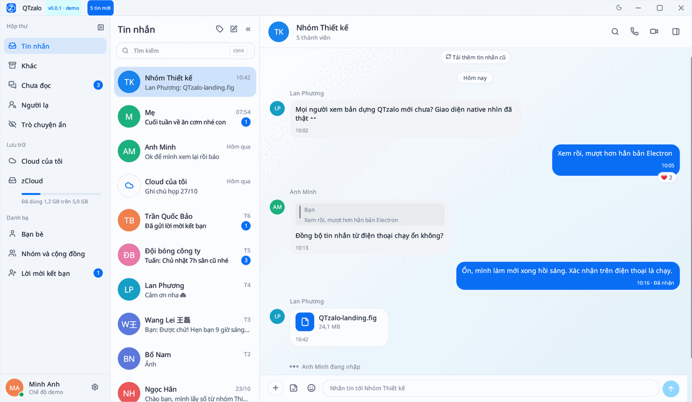

# QTzalo

Ứng dụng Zalo desktop native viết bằng Rust (`eframe`/`egui` + `ratatui`), giao tiếp trực tiếp với API và WebSocket của Zalo Web/PC, không dùng Electron hay Chromium.

QTzalo là bản fork của dự án mã nguồn mở [ctdozlite](https://github.com/ctdoteam1110/ctdozlite), tập trung vào **bảo mật dữ liệu người dùng**, **sửa các lỗi đã được cộng đồng báo cáo** và **giao diện mới** thu gọn được từng cột.

[](https://github.com/quangthoai1985/QTzalo/actions/workflows/ci-release.yml)
[](https://github.com/quangthoai1985/QTzalo/releases)
[](https://www.rust-lang.org/)
[](https://github.com/quangthoai1985/QTzalo/releases)
[](LICENSE-MIT)



> [!WARNING]
> **Ứng dụng không chính thức.** QTzalo không liên kết, không được bảo trợ hay chứng thực bởi VNG / Zalo. Giao thức được tái hiện từ việc phân tích Zalo Web/PC và có thể thay đổi bất kỳ lúc nào. Việc dùng client bên thứ ba có thể vi phạm điều khoản dịch vụ của Zalo và dẫn tới việc tài khoản bị hạn chế hoặc khoá. Hãy cân nhắc dùng tài khoản phụ để thử nghiệm. Bạn tự chịu trách nhiệm khi sử dụng.

---

## Tính năng chính

- **Đăng nhập** bằng mã QR (quét và xác nhận trên điện thoại). Phiên đăng nhập được lưu trong thư mục dữ liệu riêng của người dùng, quyền chỉ chủ sở hữu đọc được.
- **Nhắn tin thời gian thực** qua WebSocket (`zpw_ws`), dự phòng bằng HTTP polling: chat 1-1, nhóm, Cloud của tôi, trả lời trích dẫn, thả cảm xúc, ghim, thu hồi, xoá phía tôi.
- **Gửi/nhận** văn bản, hình ảnh (dán trực tiếp từ clipboard), tệp đính kèm, nhãn dán, xem trước liên kết.
- **Gợi ý nhãn dán** theo từ khoá tiếng Việt khi đang gõ.
- **Tải tệp/ảnh/video** từ tin nhắn về "Thư mục lưu file" (chỉ `https`, làm sạch tên file, không ghi đè, Mark-of-the-Web trên Windows, không tự mở file thực thi).
- **Lưu trữ cục bộ**: lịch sử tin nhắn trong SQLite, danh sách hội thoại được cache để mở app nhanh.
- **Gọi thoại và gọi video 1-1** (cần `ffmpeg` trong `PATH` cho video).
- **Hai chế độ giao diện**: GUI desktop (mặc định) và TUI cho terminal.

Danh sách thay đổi của từng phiên bản: [CHANGELOG.md](CHANGELOG.md).

---

## Cài đặt

Tải bản dựng sẵn tại **[GitHub Releases](https://github.com/quangthoai1985/QTzalo/releases)**. Mọi file đều được CI build từ mã nguồn và có `SHA256SUMS.txt` để kiểm tra.

| Hệ điều hành | File | Ghi chú |
|---|---|---|
| Windows 10/11 x64 | `QTzalo-<phiên bản>-setup-windows-x86_64.exe` | Bộ cài, không cần quyền Administrator |
| Windows 10/11 x64 | `QTzalo-<phiên bản>-portable-windows-x86_64.exe` | Chạy trực tiếp, không cần cài |
| Ubuntu 22.04+ / Debian 12+ | `qtzalo_<phiên bản>_amd64.deb` | `sudo apt install ./qtzalo_<phiên bản>_amd64.deb` |
| Linux khác | `qtzalo-<phiên bản>-linux-x86_64.tar.gz` | Giải nén rồi chạy `./install.sh` (hoặc `./install.sh --user`) |
| macOS (Apple Silicon) | `QTzalo-<phiên bản>-macos-arm64.dmg` | Bản thử nghiệm, chưa ký số |

Hướng dẫn chi tiết, kể cả cách xử lý cảnh báo Windows SmartScreen: [docs/CAI_DAT.md](docs/CAI_DAT.md).

---

## Dữ liệu người dùng được lưu ở đâu

| Hệ điều hành | Thư mục |
|---|---|
| Windows | `%APPDATA%\QTzalo` |
| Linux | `$XDG_DATA_HOME/qtzalo` (mặc định `~/.local/share/qtzalo`) |
| macOS | `~/Library/Application Support/QTzalo` |

Bên trong gồm `session.json` (phiên đăng nhập — **không chia sẻ file này**), `zalo_history.db` (lịch sử tin nhắn), `threads_cache.json`, `app_settings.json`, `stickers_cache/` (cache ảnh — xem dung lượng và xoá được trong *Cài đặt → Dữ liệu & làm mới*) và `logs/` (chỉ có khi bật chế độ `--dev`).

- Trên Linux/macOS, thư mục có quyền `0700` và file phiên có quyền `0600`.
- Có thể đổi vị trí bằng biến môi trường `QTZALO_DATA_DIR`.
- Khi khởi động, các file cũ do bản trước để lại trong thư mục làm việc hiện tại (`session.json`, `zalo_history.db`, …) được tự động chuyển vào thư mục trên nếu ở đó chưa có dữ liệu.
- Gỡ cài đặt **không** xoá thư mục dữ liệu, trừ khi bạn đồng ý ở hộp thoại hỏi khi gỡ (Windows) hoặc chạy `./uninstall.sh --purge` (Linux).

---

## Tự build từ mã nguồn

### Yêu cầu chung

- **Rust ≥ 1.88** (khuyến nghị bản stable mới nhất qua [rustup](https://rustup.rs/)). Đã kiểm chứng: Rust 1.87 không build được vì một số dependency trong `Cargo.lock` yêu cầu 1.88.
- **CMake**, `pkg-config` và trình biên dịch C/C++ (để build tĩnh `libopus` và `sqlite3`).
- **FFmpeg** trong `PATH` (tuỳ chọn, chỉ cần cho gọi video).
- Với **CMake 4.x**, đặt biến môi trường `CMAKE_POLICY_VERSION_MINIMUM=3.5` khi build.

### Windows (MSVC)

Cài *Visual Studio Build Tools* với workload *Desktop development with C++* (gồm cả *CMake tools for Windows*), rồi trong PowerShell:

```powershell
git clone https://github.com/quangthoai1985/QTzalo.git
cd QTzalo
$env:CMAKE_POLICY_VERSION_MINIMUM = "3.5"
cargo build --release --locked
```

Kết quả: `target\release\zalo-rust.exe`. Để tạo bộ cài giống bản phát hành, cài [Inno Setup 6](https://jrsoftware.org/isinfo.php) rồi chạy:

```powershell
iscc /DMyAppVersion=0.1.0 packaging\windows\installer.iss
```

Bộ cài được tạo trong thư mục `dist\`.

### Linux

Ubuntu / Debian:

```bash
sudo apt install -y build-essential cmake pkg-config libasound2-dev libxcb-render0-dev libxcb-shape0-dev libxcb-xfixes0-dev libxkbcommon-dev
```

Fedora:

```bash
sudo dnf install -y gcc gcc-c++ make cmake pkgconf-pkg-config alsa-lib-devel libxcb-devel libxkbcommon-devel
```

Arch Linux:

```bash
sudo pacman -S --needed base-devel cmake pkgconf alsa-lib libxcb libxkbcommon
```

Build:

```bash
CMAKE_POLICY_VERSION_MINIMUM=3.5 cargo build --release --locked
```

Tuỳ chọn khi chạy: `zenity` hoặc `kdialog` (hộp thoại chọn file), `xclip` / `wl-clipboard` (dán ảnh), `fonts-noto-core` + `fonts-noto-cjk` (hiển thị tiếng Việt và chữ Hán).

Kiểm tra nhanh phần mã dành riêng cho Windows ngay trên Linux (dùng MinGW-w64):

```bash
scripts/check-windows.sh
```

### macOS

```bash
xcode-select --install
brew install cmake pkg-config opus ffmpeg
cargo build --release --locked
```

---

## Sử dụng

| Lệnh | Tác dụng |
|---|---|
| `zalo-rust` hoặc `zalo-rust --gui` | Mở giao diện đồ hoạ (mặc định) |
| `zalo-rust --tui --qr` | Giao diện terminal, đăng nhập bằng QR |
| `zalo-rust --gui --dev` | Bật Dev Inspector và ghi log chẩn đoán vào thư mục `logs/` |
| `zalo-rust --logout` | Xoá phiên đăng nhập đã lưu rồi thoát |
| `zalo-rust --version` | In phiên bản |

Bản cài trên Windows đặt tên file chạy là `QTzalo.exe`; bản `.deb` / `.tar.gz` trên Linux cài lệnh `qtzalo`. Các tham số giống hệt nhau.

Chi tiết phím tắt và thao tác: [docs/HUONG_DAN_SU_DUNG.md](docs/HUONG_DAN_SU_DUNG.md).

---

## Phát hành phiên bản mới

`Cargo.toml` là nguồn duy nhất của số phiên bản. Workflow [`ci-release.yml`](.github/workflows/ci-release.yml) đọc phiên bản từ đó cho mọi tên file, bộ cài và metadata.

1. Tăng `version` trong `Cargo.toml` và cập nhật [CHANGELOG.md](CHANGELOG.md), `.github/release-notes.md`.
2. Push lên GitHub, đợi CI xanh.
3. Phát hành theo một trong hai cách:
   - Vào tab **Actions → CI & Release → Run workflow**, chọn nhánh, tick **release**, bấm Run. Workflow tự tạo tag `v<phiên bản>` tại commit vừa build.
   - Hoặc push tag `v<phiên bản>`. Tag phải khớp phiên bản trong `Cargo.toml`, nếu không workflow sẽ dừng với lỗi.

Release chỉ được tạo khi job test và job Windows đều thành công. Job Linux và macOS không bắt buộc: file nào build được sẽ được đính kèm.

---

## Bảo mật

- Chính sách báo cáo lỗ hổng và mô tả dữ liệu được lưu: [SECURITY.md](SECURITY.md).
- Kết quả rà soát bảo mật và trạng thái khắc phục: [docs/SECURITY_AUDIT.md](docs/SECURITY_AUDIT.md).
- Bộ cài Windows **chưa được ký số**, nên SmartScreen có thể cảnh báo. Hãy kiểm tra SHA256 với `SHA256SUMS.txt` trong trang Release trước khi chạy.

---

## Cấu trúc mã nguồn

```text
src/
├── main.rs          # Điểm vào CLI: --gui, --tui, --dev, --logout, --version
├── paths.rs         # Thư mục dữ liệu theo người dùng, ghi file quyền riêng tư, chuyển dữ liệu cũ
├── timefmt.rs       # Định dạng giờ theo múi giờ của máy (chrono::Local)
├── session.rs       # Phiên, cookie zpw_sek, khoá phiên, bảng domain
├── crypto.rs        # AES-CBC, MD5, signkey
├── param_cipher.rs  # ParamCipher v2
├── qr.rs            # Đăng nhập QR
├── login.rs         # getServerInfo, getLoginInfo, đăng nhập mật khẩu
├── socket.rs        # WebSocket thời gian thực
├── chat.rs          # Hội thoại, tin nhắn, nhóm, đính kèm, link preview, sticker
├── store.rs         # Lịch sử SQLite
├── call.rs          # Báo hiệu cuộc gọi, ZRTP relay
├── media.rs         # RTP/RTCP, H.264, webcam/video
├── audio.rs         # Thu/phát âm thanh (cpal + opus)
├── voip_log.rs      # Log chẩn đoán RTP/RTCP (chỉ ở chế độ dev)
├── logger.rs        # Log mạng trong bộ nhớ cho Dev Inspector
├── tui.rs           # Giao diện terminal (ratatui)
└── gui/             # Giao diện desktop (eframe/egui)
```

Tài liệu kỹ thuật khác nằm trong [docs/](docs/README.md).

---

## Ghi công

- Dự án gốc: **[ctdozlite](https://github.com/ctdoteam1110/ctdozlite)** của ctdoteam1110 / TIPC1110. Toàn bộ phần phân tích giao thức Zalo và nền tảng ứng dụng đến từ dự án này.
- Cảm ơn các thành viên cộng đồng đã báo lỗi và phân tích nguyên nhân trên repo gốc (đặc biệt các issue #3, #4, #5, #6, #12, #21, #22, #23).

## Giấy phép

Phân phối theo giấy phép kép **[MIT](LICENSE-MIT) OR [Apache-2.0](LICENSE-APACHE)**, giống dự án gốc. Bản quyền phần mã gốc thuộc các tác giả ctdozlite; phần thay đổi thuộc người đóng góp cho QTzalo.
