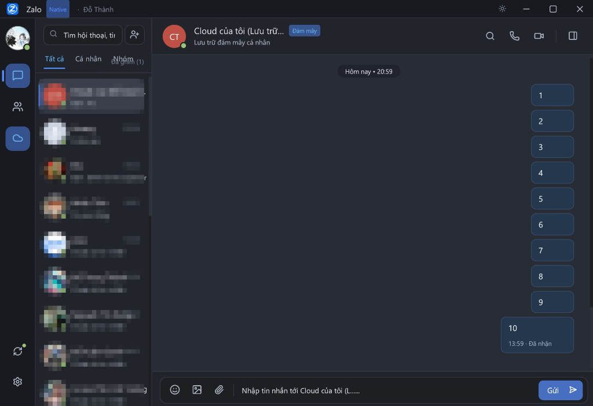

# ctdozlite

**[Tiếng Việt](README.md)** · **[English](README_EN.md)** · **[한국어](README_KO.md)** · **[日本語](README_JA.md)** · **[简体中文](README_ZH.md)**


Client Zalo Desktop viết bằng Rust (`eframe`/`egui` + `ratatui`), giao tiếp trực tiếp với hệ thống API và WebSocket của Zalo Web/PC mà không qua Electron hay Chromium.

- **Trang chủ dự án (Website & Tải nhanh):** [https://ctdozlite.ctdo.net/](https://ctdozlite.ctdo.net/)
- **Gói cài đặt dựng sẵn (Releases):** [https://github.com/ctdoteam1110/ctdozlite/releases](https://github.com/ctdoteam1110/ctdozlite/releases)
- **Tính năng nào đang chạy?** [Tính năng & giới hạn](docs/TINH_NANG.md) · [Đã biết](docs/DA_BIET.md) · [Xử lý sự cố](docs/KHAC_PHUC_SU_CO.md)

> Chưa rõ tính năng bạn cần đã hoạt động chưa? Đọc [Tính năng & giới hạn](docs/TINH_NANG.md) **trước khi** mở issue — bảng đó ghi rõ cái gì đang chạy, cái gì chỉ chạy một phần và issue nào đang theo dõi.


> [!NOTE]
> **Tuyên bố miễn trừ trách nhiệm (Disclaimer):** Dự án này là một nghiên cứu kỹ thuật hệ thống độc lập mã nguồn mở vì mục đích học tập, giáo dục và tương thích giao thức (*Educational & Interoperability Research Purposes Only*). Dự án **KHÔNG** có bất kỳ mối liên hệ, hợp tác, tài trợ hay bảo trợ nào từ VNG Corporation hay Zalo, và hoàn toàn phi thương mại (100% mã nguồn mở, không thu phí, không quảng cáo, không đóng gói tài nguyên độc quyền). Người dùng tự chịu mọi trách nhiệm khi sử dụng phần mềm này.
[](https://ctdozlite.ctdo.net/)
[](https://github.com/ctdoteam1110/ctdozlite/releases)
[](https://github.com/ctdoteam1110/ctdozlite/actions/workflows/ci-release.yml)
[](https://www.rust-lang.org/)
[](https://github.com/ctdoteam1110/ctdozlite/releases)
[](LICENSE-MIT)



---

## Tổng quan

Bản Zalo PC chính thức đóng gói trên Electron thường chiếm 350–600 MB RAM khi chạy nền. `ctdozlite` được viết lại từ đầu bằng Rust dựa trên phân tích luồng giao thức của Zalo Web/PC (`zpw_ver=694`, `zpw_type=30`), tập trung vào tốc độ phản hồi, mức tiêu thụ tài nguyên thấp và khả năng đóng gói thành một binary duy nhất.

| Chỉ số thực tế | Zalo PC 26.10.11 (Electron) | ctdozlite (Rust Native) |
|---|---|---|
| **RAM khi chờ (Working Set)** | **1.800 – 1.975 MB** | **~149,5 MB** (tiết kiệm hơn 92% RAM) |
| **Số tiến trình chạy nền** | 7 tiến trình | **1 tiến trình duy nhất** |
| **Kích thước file thực thi** | ~136 MB | **~17,2 MB** (bản phát hành strip symbols) |
| **Thời gian khởi chạy cửa sổ** | 2.5 – 4.0s | **~0,18 – 0,19 giây** (< 200ms) |
| **Phụ thuộc runtime** | Chromium, Node.js | Native binary thuần (`ffmpeg` tùy chọn nếu gọi video) |

> *Dữ liệu đo thực tế trên Windows 11 (Intel Core i7-12700H, PowerShell `Get-Process WorkingSet64`, đo trung vị sau 15 giây chạy ổn định ở trạng thái chờ).*

---

## Các tính năng chính

- **Xác thực & Quản lý phiên (`src/qr.rs`, `src/login.rs`, `src/session.rs`)**
  - Đăng nhập qua mã QR (`reqqr`, long-polling chờ quét và xác nhận trên điện thoại) hoặc mật khẩu (`PasswordCipher` + `ParamCipher v2`).
  - Lưu phiên tại `session.json`, tự động kiểm tra `zpw_sek` khi mở lại và chuyển về màn hình QR nếu phiên đã hết hạn trên server.
- **Nhắn tin thời gian thực (`src/chat.rs`, `src/socket.rs`, `src/store.rs`)**
  - Kết nối WebSocket (`zpw_ws` frame binary AES-GCM/deflate) kết hợp HTTP polling dự phòng (`get_last_msgs`).
  - Hỗ trợ chat cá nhân (1-1), nhóm (`getlg/v4`), Cloud của tôi, trả lời trích dẫn (quote), chuyển tiếp, thả cảm xúc (reaction), ghim, đánh dấu sao, thu hồi tin nhắn với mọi người và xóa phía người dùng.
  - Gửi/nhận văn bản, hình ảnh (hỗ trợ dán trực tiếp từ clipboard `Ctrl+V` / `Cmd+V`), tập tin đính kèm, nhãn dán và xem trước liên kết (OpenGraph / `parselink`).
  - Tự động phân giải tên hiển thị và avatar cho số lạ thông qua `getminiprofiles`.
- **Gợi ý & Tìm kiếm Sticker theo ngữ cảnh (`src/chat.rs`, `src/gui/stickers.rs`)**
  - Tự động gợi ý nhãn dán ngay trên thanh soạn thảo khi gõ từ khóa, cụm từ tiếng Việt hoặc biểu tượng cảm xúc (tương tự `chat.zalo.me`).
  - Truy vấn song song hai endpoint `/api/message/sticker/suggest/stickers` (`cmd 11741`) và `/api/message/sticker/search` (`cmd 11747`), tự động đối chiếu cả biến thể tiếng Việt có dấu, không dấu và từ viết tắt phổ biến (`tks`, `hpbd`, `g9`, `met qua` ↔ `mệt quá`, `co len` ↔ `cố lên`...).
  - Hỗ trợ tìm kiếm theo cụm từ cuối câu và tải trước (prefetch) ảnh sticker song song ở luồng nền, lưu cache tại `stickers_cache/`.
- **Lưu trữ cục bộ 2 tầng (`src/store.rs`)**
  - `threads_cache.json`: Snapshot danh sách hội thoại giúp hiển thị giao diện ngay khi mở app.
  - `zalo_history.db` (SQLite): Lưu trữ lịch sử tin nhắn cục bộ trên máy, khử trùng lặp theo `msg_id` và mốc thời gian. Ứng dụng không gửi dữ liệu sang bất kỳ máy chủ bên thứ ba nào ngoài hệ thống Zalo; khuyến nghị bật mã hóa ổ đĩa hệ điều hành (BitLocker / FileVault / LUKS) nếu dùng trên máy chung.
- **Gọi thoại & Gọi video 1-1 (`src/call.rs`, `src/media.rs`, `src/audio.rs`)**
  - Triển khai trực tiếp luồng báo hiệu cuộc gọi (`401`/`416`/`407`/`402`/`408`/`409`) và bắt tay ZRTP relay bằng Rust, không phụ thuộc `ZaloCall.exe`.
  - Audio hai chiều qua `cpal` + `opus`; video H.264 đóng gói theo khung relay của Zalo (RTP PT 97/98, RTCP SR/PLI/REMB) kết hợp `ffmpeg` để thu webcam và giải mã khung hình.
- **Hai chế độ giao diện (`src/gui/`, `src/tui.rs`)**
  - **GUI (`eframe`/`egui`)**: Giao diện desktop native, hỗ trợ Dark/Light theme, điều hướng sticker bằng phím mũi tên, thông báo tin nhắn chưa đọc và khay Dev Inspector (`--dev`).
  - **TUI (`ratatui`/`crossterm`)**: Giao diện terminal gọn nhẹ cho môi trường CLI/SSH.

---

## Cấu trúc mã nguồn

```text
src/
├── main.rs            # Điểm vào CLI, phân tích tham số khởi chạy (--gui, --tui, --dev, --logout)
├── lib.rs             # Khai báo các module thư viện
├── session.rs         # Quản lý phiên, cookie jar (zpw_sek), khóa giải mã (zpw_enk) và bảng domain
├── crypto.rs          # AES-128/256-CBC, PKCS7, MD5 và hàm tạo chữ ký signkey
├── param_cipher.rs    # Mã hóa tham số xác thực ParamCipher v2 (zcid, zcid_ext, encrypt_key)
├── qr.rs              # Luồng sinh mã QR, long-polling chờ quét và xác nhận đăng nhập
├── login.rs           # Đăng nhập mật khẩu (PasswordCipher), getServerInfo, getLoginInfo
├── socket.rs          # Kết nối WebSocket thời gian thực (zpw_ws)
├── chat.rs            # API hội thoại, tin nhắn, nhóm, đính kèm, link preview và tìm kiếm sticker
├── store.rs           # Lưu trữ SQLite (zalo_history.db) và đồng bộ lịch sử
├── call.rs            # Báo hiệu VoIP, điều khiển phiên gọi 1-1 và bắt tay ZRTP
├── media.rs           # Đóng gói/giải mã RTP/RTCP, H.264 FU-A và luồng webcam/video
├── audio.rs           # Thu/phát âm thanh thời gian thực (cpal + libopus)
├── voip_log.rs        # Ghi nhận chẩn đoán luồng gói tin RTP/RTCP (voip.log)
├── logger.rs          # Bộ thu thập log mạng và quét mã lỗi cho chế độ --dev
├── tui.rs             # Giao diện dòng lệnh (ratatui)
└── gui/               # Giao diện đồ họa native (eframe/egui)
    ├── theme.rs       # Bảng màu Dark/Light, vector icon Lucide, nạp font hệ thống
    ├── stickers.rs    # Sticker picker, auto-suggest khi gõ và bộ lọc nhãn dán
    ├── worker.rs      # Luồng nền Tokio xử lý lệnh mạng và prefetch ảnh/sticker
    ├── workspace.rs   # Bố cục cột danh bạ, khung chat chính và ngăn thông tin hội thoại
    ├── messages.rs    # Render bong bóng tin nhắn, reaction, quote, ảnh clipboard
    └── modals.rs      # Hộp thoại cài đặt, cuộc gọi, xem ảnh, tra cứu SĐT và Dev Inspector
```

---

## Tải bản cài đặt dựng sẵn

Toàn bộ gói cài đặt cho từng hệ điều hành và bản phân phối Linux nằm tại **[GitHub Releases](https://github.com/ctdoteam1110/ctdozlite/releases)**. Trang này luôn hiển thị bản mới nhất, không cần sửa link khi phát hành phiên bản tiếp theo.

Hướng dẫn cài đặt chi tiết (Linux, Windows, macOS Apple Silicon `arm64` / Intel `x86_64` / Universal `.dmg`, kiểm tra SHA-256 và gỡ cài đặt): **[docs/CAI_DAT.md](docs/CAI_DAT.md)**.

> [!IMPORTANT]
> **Phiên bản iOS — Dùng 1 tài khoản Zalo song song trên 2 máy (Sắp ra mắt):**
> Bản iOS của `ctdozlite` hoạt động dưới dạng phiên phụ (`zpw_type=30`), cho phép đăng nhập và sử dụng **chung 1 tài khoản Zalo song song trên 2 máy điện thoại** mà không làm văng thiết bị chính. Hiện tại tài khoản Apple Developer của mình vừa bị Apple thu hồi chứng chỉ và phần giao diện cảm ứng chưa hoàn thiện trọn vẹn, nên gói `.ipa` sẽ sớm được bổ sung trong bản cập nhật tới.

---

## Tự biên dịch từ mã nguồn (Windows / Linux / macOS)

### 1. Yêu cầu chung
- **Rust** 1.75 trở lên ([rustup.rs](https://rustup.rs/))
- **CMake** (3.15+), `pkg-config` và trình biên dịch C/C++ (để biên dịch tĩnh `libopus` và `sqlite3`)
- **FFmpeg** trong `PATH` (tùy chọn — chỉ cần khi sử dụng tính năng gọi video H.264)

> Nếu máy dùng CMake 4.0+ gặp lỗi kiểm tra phiên bản tối thiểu trong `opus-sys`, đặt biến môi trường `CMAKE_POLICY_VERSION_MINIMUM=3.5` khi chạy `cargo build`.

### 2. Windows (MSVC)
Cài đặt *Visual Studio Build Tools* (chọn *Desktop development with C++* và *CMake tools for Windows*):

```powershell
winget install Gyan.FFmpeg
git clone https://github.com/ctdoteam1110/ctdozlite.git
cd ctdozlite
$env:CMAKE_POLICY_VERSION_MINIMUM = "3.5"
cargo build --release
```
Binary đầu ra: `target\release\ctdozlite.exe`

### 3. Linux (Debian / Ubuntu / Fedora / Arch)
Cài đặt các gói thư viện hệ thống cho âm thanh (`ALSA`) và cửa sổ (`X11` / `Wayland` / `GTK3`):

- **Ubuntu / Debian:**
  ```bash
  sudo apt update
  sudo apt install -y build-essential cmake pkg-config \
    libasound2-dev libxcb-render0-dev libxcb-shape0-dev \
    libxcb-xfixes0-dev libxkbcommon-dev libssl-dev \
    libgtk-3-dev zenity xclip wl-clipboard ffmpeg
  ```
- **Fedora:**
  ```bash
  sudo dnf install -y gcc gcc-c++ make cmake pkgconf-pkg-config \
    alsa-lib-devel libxcb-devel libxkbcommon-devel openssl-devel \
    gtk3-devel zenity xclip wl-clipboard ffmpeg
  ```
- **Arch Linux:**
  ```bash
  sudo pacman -S --needed base-devel cmake pkgconf alsa-lib \
    libxcb libxkbcommon openssl gtk3 zenity xclip wl-clipboard ffmpeg
  ```

Biên dịch:
```bash
git clone https://github.com/ctdoteam1110/ctdozlite.git
cd ctdozlite
CMAKE_POLICY_VERSION_MINIMUM=3.5 cargo build --release
```
Binary đầu ra: `target/release/ctdozlite`

### 4. macOS (Apple Silicon ARM64 & Intel x86_64)
```bash
xcode-select --install
brew install cmake ffmpeg
git clone https://github.com/ctdoteam1110/ctdozlite.git
cd ctdozlite
cargo build --release
```
Binary đầu ra: `target/release/ctdozlite` *(Tự động liên kết tĩnh `libopus.a` qua `.cargo/config.toml` + `packaging/macos/toolchain-*.cmake`, không cần cài `opus` rời qua Homebrew)*.

---

## Sử dụng

### Chạy giao diện đồ họa (GUI - mặc định)
```bash
./target/release/ctdozlite --gui
```
- Quét mã QR bằng ứng dụng Zalo trên điện thoại và xác nhận đăng nhập.
- Khi gõ các từ/cụm từ cảm xúc trong ô chat (`xin chào`, `cảm ơn`, `khóc`, `nhớ`, `cố lên`, `mệt quá`, `đi chơi`...), thanh gợi ý nhãn dán sẽ tự động hiển thị phía trên ô nhập. Có thể bấm chuột hoặc dùng phím `↑` `←` `→` `Enter` để chọn và gửi nhanh, hoặc nhấn `Esc` để đóng.

### Chạy giao diện dòng lệnh (TUI)
```bash
./target/release/ctdozlite --tui --qr
```
- Điều hướng bằng `↑`/`↓` (hoặc `j`/`k`), nhấn `Enter` để gửi tin nhắn, `Tab` để đổi vùng chọn, `r` để làm mới danh sách và `q` để thoát.

### Chế độ chẩn đoán giao thức (Dev Inspector)
```bash
./target/release/ctdozlite --gui --dev
```
- Hiển thị thêm bảng kiểm tra request/response, thời gian phản hồi, payload đã giải mã và trạng thái khóa phiên.

### Đăng xuất và xóa phiên
```bash
./target/release/ctdozlite --logout
```

---

## Đóng gói đa nền tảng (CI/CD)

Workflow GitHub Actions tại [`.github/workflows/ci-release.yml`](.github/workflows/ci-release.yml) tự động chạy `cargo test`, đóng gói và phát hành lên [GitHub Releases](https://github.com/ctdoteam1110/ctdozlite/releases) khi đẩy tag `v*`:

- **Linux (5 gói tương thích đa distro):**
  - `.deb` chuẩn (Debian 12+ / Ubuntu 22.04, 24.04+ / Mint 21+)
  - `.deb` legacy `glibc 2.31` (Debian 11 / Ubuntu 20.04+ / Mint 20+)
  - `.rpm` (Fedora / RHEL / Rocky / AlmaLinux / openSUSE)
  - `.AppImage` (gói thực thi độc lập chạy trên mọi bản Linux)
  - `.tar.gz` bản chuẩn và legacy (kèm script `install.sh` / `uninstall.sh`)
- **Windows:** bộ cài `.exe` và bản portable `.exe` ([`packaging/windows/installer.iss`](packaging/windows/installer.iss))
- **macOS (Apple Silicon + Intel + Universal):** `ctdozlite-<version>-macos-arm64.dmg` (Chip M1/M2/M3/M4), `ctdozlite-<version>-macos-x86_64.dmg` (Mac Intel), và `ctdozlite-<version>-macos.dmg` (Universal Binary `lipo`) ([`packaging/macos/Info.plist`](packaging/macos/Info.plist))

---

## Phiên bản & Phát hành

`Cargo.toml` là nguồn phiên bản duy nhất (`version = "x.y.z"`). Workflow đọc giá trị này và dùng nó cho mọi tên gói cài, metadata `.deb`/`.rpm`, bộ cài Windows, `Info.plist` và release. Không sửa số phiên bản ở nơi khác.

Quy trình phát hành:

1. Cập nhật `version` trong `Cargo.toml`, chạy `cargo check` để làm mới `Cargo.lock`.
2. Merge thay đổi vào `main`.
3. Tạo tag `v<version>` trỏ tới một commit trên `main` rồi push tag. CI sẽ build, test và publish release; phần mô tả release được GitHub tự sinh từ các PR đã merge.

CI từ chối phát hành nếu tag không khớp `Cargo.toml` hoặc commit của tag không nằm trên `main`.

Lịch sử phát hành và ghi chú thay đổi: **[GitHub Releases](https://github.com/ctdoteam1110/ctdozlite/releases)**.

---

## Tài liệu chi tiết

- [docs/CAI_DAT.md](docs/CAI_DAT.md): Cài đặt trên Linux, Windows và macOS; kiểm tra SHA-256 và gỡ cài đặt.
- [docs/HUONG_DAN_SU_DUNG.md](docs/HUONG_DAN_SU_DUNG.md): Các cờ CLI, phím tắt GUI/TUI và cách dùng các tính năng trong app.
- [docs/KIEN_TRUC_HE_THONG.md](docs/KIEN_TRUC_HE_THONG.md): Thiết kế luồng giao diện, luồng worker bất đồng bộ và lưu trữ SQLite + JSON.
- [docs/GIAO_THUC_ZALO.md](docs/GIAO_THUC_ZALO.md): Ghi chú về `ParamCipher v2`, `PasswordCipher`, `signkey` MD5 và bảng domain.
- [docs/KHAC_PHUC_SU_CO.md](docs/KHAC_PHUC_SU_CO.md): Giải thích các mã lỗi máy chủ Zalo thường gặp và cách xử lý.

---

## Lưu ý bảo mật

- `session.json` chứa cookie `zpw_sek`, khóa giải mã `zpw_enk` và định danh thiết bị của phiên đang đăng nhập. Không chia sẻ hoặc commit file này lên kho mã nguồn.
- Các tệp dữ liệu cục bộ (`session.json`, `zalo_history.db`, `threads_cache.json`, `stickers_cache/`, `*.log`) đã được cấu hình loại trừ trong `.gitignore`.

---


## 🏆 Key Contributors

Dự án ghi nhận các thành viên có đóng góp mã nguồn tiêu biểu trực tiếp vào repository:

| Contributor | GitHub | Đóng góp chính | Khối lượng |
| :--- | :--- | :--- | :---: |
| **TIPC1110** | [@TIPC1110](https://github.com/TIPC1110) | Kiến trúc lõi, VoIP call engine, egui framework, Nhật ký Social, đa nền tảng | **> 77,000+ lines** |
| **thanhdo1110** | [@thanhdo1110](https://github.com/thanhdo1110) | Tái cấu trúc GUI modular, giao diện Atom One Dark, MCP/REST API & Hẹn giờ tin nhắn | **> 20,000+ lines** |
| **Thuong Tin** | [@thuongtin](https://github.com/thuongtin) | Loạt 7 PRs: Múi giờ OS, tùy biến data-dir, helpers macOS, session atomic, media cache, updater, message state | **> 5,950+ lines** 🏆 |
| **ngxccc** | [@ngxccc](https://github.com/ngxccc) | Loạt 5 PRs: Tiêu chuẩn kỹ thuật, bảo toàn session an toàn, phân giải domain mạng | **> 3,090+ lines** |
| **GrootTheDeveloper** | [@GrootTheDeveloper](https://github.com/GrootTheDeveloper) | Loạt 8 PRs: Tối ưu khởi động SQLite, đồng bộ lịch sử nhóm/Cloud (#45), poll timer worker (#46), virtualization chat, lazy load Font CJK | **> 760+ lines** |

> *Ghi chú: Toàn bộ danh sách vinh danh mọi cá nhân đóng góp (báo lỗi, đề xuất tính năng, pull request) được cập nhật công khai tại trang [Người đóng góp](https://ctdozlite.ctdo.net/contributors.html).*

<details>
<summary><b>👉 Nhấn vào đây để xem toàn bộ danh sách 70 người đóng góp (Community & GitHub)</b></summary>

| # | Người đóng góp | Hạng mục | Đóng góp chi tiết |
| :---: | :--- | :--- | :--- |
| 1 | **Le Nhat** | `Lỗi crash` | Báo cáo lỗi văng app nghiêm trọng khi thực hiện tìm kiếm tên liên hệ hoặc hội thoại trên Windows 11. |
| 2 | **Ken Đoàn** | `Đồng bộ` | Báo lỗi bấm nút đồng bộ nhưng mãi không đồng bộ được tin nhắn cũ từ máy chủ Zalo. |
| 3 | **Nguyễn Vang** | `Độ ổn định` | Thử nghiệm bản phát hành đầu tiên và phản hồi về độ ổn định trong quá trình duy trì kết nối chat. |
| 4 | **Không Là Gì Cả** | `Tính năng` | Đề xuất chức năng backup tin nhắn và ảnh qua Telegram, vì Zalo tự xóa ảnh sau 1 năm làm mất ảnh kỷ niệm. Tác giả đã đồng ý ('oce bác'). |
| 5 | **Tuấn Anh Pham** | `Quyền riêng tư` | Đề xuất chặn trạng thái 'Đã xem' (Seen) và ẩn đang gõ (Typing); sau đó bổ sung đề nghị thêm tuỳ chỉnh theme. Tác giả xác nhận đã có tính năng nhưng chưa có thời gian kiểm chứng. |
| 6 | **Khoai Possible** | `macOS` | Thử nghiệm bản dựng cho hệ điều hành macOS (Apple Silicon ARM64, Intel x86_64 & Universal DMG) và phản hồi trải nghiệm. |
| 7 | **So Dep Thanh Nam** | `iOS` | Đề xuất phát triển phiên bản iOS và lưu ý ưu tiên khả năng tương thích với các máy iOS đời thấp. |
| 8 | **Xanh Chín** | `iOS` | Bày tỏ nhu cầu trải nghiệm client Zalo gọn nhẹ trên hệ sinh thái Apple iOS. |
| 9 | **Huy Nguyen** | `iOS` | Đề xuất mở rộng ctdozlite sang nền tảng iOS và thảo luận về tính bảo mật mã nguồn mở trên di động. |
| 10 | **Nguyễn Đức Huy** | `Android` | Đề xuất phát triển phiên bản client mã nguồn mở gọn nhẹ cho các thiết bị Android. |
| 11 | **Trương Công Huy** | `Phản hồi` | Đánh giá cao chất lượng và tính đột phá của ứng dụng ctdozlite. |
| 12 | **Dân Bách Phong** | `Phản hồi` | Động viên và tương tác tích cực với dự án ngay từ những giờ đầu phát hành v0.0.1. |
| 13 | **Vũ Minh Khang** | `Kết nối` | Giới thiệu bạn bè và cộng đồng kỹ thuật tham gia kiểm thử phần mềm. |
| 14 | **Nam Khánh** | `Thử nghiệm` | Tham gia đánh giá chất lượng trải nghiệm của client Rust so với bản web. |
| 15 | **Bùi Phương** | `Tìm hiểu` | Thảo luận về cơ chế hoạt động và cách thức cài đặt ứng dụng. |
| 16 | **Trương Ngọc Khánh** | `Tương tác` | Tương tác, theo dõi và đóng góp phản hồi trong bài viết công bố sản phẩm. |
| 17 | **Nhat Nguyen** | `Lỗi crash` | Bản cài Win 11 gặp 5 vấn đề: phải End Task trong Task Manager mới thoát được app; bấm đồng bộ nhưng không thấy tin nhắn; luôn hiển thị online ở mọi user; gọi đi không được; không bật được camera khi video call. Sẵn sàng test tiếp cho tác giả. |
| 18 | **Nguyễn Vĩnh Huy** | `Kiến trúc` | Trao đổi về cách một tài khoản đăng nhập song song 2 thiết bị: nhiều khả năng client trên máy thứ hai dùng slot của bản Zalo Web. |
| 19 | **Giao Chung** | `Phản hồi` | Khen chất lượng sản phẩm dù bản thân đã ngừng sử dụng Zalo. |
| 20 | **Nguyen Hoa** | `Theo dõi` | Theo dõi và chờ đợi các bản cập nhật tiếp theo của ctdozlite. |
| 21 | **Nguyễn Thành Công** | `Android` | Hưởng ứng đề xuất phát triển bản Android và tham gia thảo luận về nhu cầu đa nền tảng. |
| 22 | **Ngô Hoàng Trọng Tín** | `Tính năng` | Xin khôi phục lại bộ icon con mèo trong giao diện. Bình luận nhận được 20 lượt thả tim, nhiều người dùng quan tâm. |
| 23 | **Sơn Minh** | `Định hướng` | Đề nghị cân nhắc phát triển lâu dài để tính năng chạy tốt và mượt mà; nếu có thời gian thì thử viết lại toàn bộ backend theo hướng thay thế Zalo, và cam kết sẽ đóng góp nếu làm. |
| 24 | **Nguyễn Lợi** | `Tính năng` | Đề xuất làm thêm bản Telegram vì bản chạy nền hiện đã ăn tới 1GB RAM. |
| 25 | **Tiến Bộ** | `Thử nghiệm` | Dự định thử nghiệm trên macOS; nhận xét bản chuẩn thì nặng, bản basic dùng ctdozlite, khi cần tác vụ nặng thì quay lại bản chuẩn. |
| 26 | **Giang Tran Vu** | `Kinh nghiệm` | Cho AI reverse-engineer để viết lại bằng Rust kèm Liquid Glass, treo máy liên tục khoảng 7 giờ thì hoàn thành. |
| 27 | **Hoàng Sanh** | `Động viên` | Dành lời khen và động viên tác giả sau khi dùng thử sản phẩm. |
| 28 | **Trần Văn Quốc** | `iOS` | Bày tỏ mong đợi bản phát hành dành cho iOS. |
| 29 | **Cốn Cái Lò** | `Kiến trúc` | Tham gia trao đổi về cách một tài khoản đăng nhập song song trên hai thiết bị. |
| 30 | **Mai Anh Tuan** | `Cảnh báo` | Nhận xét sản phẩm chưa ổn và lưu ý tác giả cẩn thận về vấn đề luật sở hữu trí tuệ. |
| 31 | **Jason Wu** | `Tương tác` | Tham gia bình luận, trao đổi cùng cộng đồng dưới bài phát hành. |
| 32 | **Phúc** | `Lỗi macOS` | Hỏi phiên bản macOS tối thiểu; dùng Sonoma trên máy Intel thì không mở được ứng dụng. Tác giả đã trả lời: cần chip Apple Silicon (chip M). |
| 33 | **Dương** | `Phản hồi` | Bình luận tương tác dưới bài phát hành, nhận 8 lượt thả tim. |
| 34 | **Nguyen Quang Huy** | `iOS` | Bày tỏ mong đợi bản phát hành cho iOS. |
| 35 | **Phan Quoc Trieu** | `Đa nền tảng` | Đề nghị nghiên cứu thêm chức năng cho iPhone và các dòng máy Android khác để dùng được đa thiết bị. |
| 36 | **Minh Phung** | `iOS` | Mong bản iOS có và hỗ trợ được cả các dòng iPhone đời cũ. |
| 37 | **Le Quang Huy** | `Kiến trúc` | Nhận xét cơ chế này giống việc một bên dùng app còn một bên dùng nền web. |
| 38 | **Trung Minh** | `Tính năng` | Đề xuất làm luôn tính năng chat từ Telegram tới bạn bè bên Zalo, để không phải mở ứng dụng Zalo nữa. |
| 39 | **Thanh Dev** | `Kỹ thuật` | Hỏi lại cách dùng AI để reverse-engineer, mở ra một chuỗi trao đổi kỹ thuật có giá trị trong phần bình luận. |
| 40 | **Ngoc Do** | `Kỹ thuật` | Xin prompt để dùng AI reverse-engineer; được tác giả khác chia sẻ lại quy trình chi tiết gồm đọc file cài, so sánh với bản gốc và thảo luận chéo giữa các model. |
| 41 | **Hoa Thiên Lý** | `Động viên` | Cho biết sẽ tải ứng dụng về dùng chỉ vì bộ icon con mèo được nhắc trong bình luận. |
| 42 | **Nguyễn Duy Khánh** | `Ủng hộ` | Hưởng ứng đề xuất khôi phục bộ icon con mèo của Ngô Hoàng Trọng Tín. |
| 43 | **Cao Nhật Minh** | `Bình luận` | Đưa ra góc nhìn so sánh giữa Zalo và dự án mã nguồn mở trong phần bình luận. |
| 44 | **Subaru Wrx** | `Bảo mật` | Đặt câu hỏi về rủi ro bảo mật: lưu lịch sử chat vào SQLite cục bộ thì có dễ bị thu thập dữ liệu hay không. |
| 45 | **Phạm Hoàn** | `Định hướng` | Bình luận mới nhất trong bài: cho rằng sản phẩm hay và cần được phát triển thêm tính năng. |
| 46 | **Long Nguyễn** | `Góp ý` | Trao đổi với Ngô Hoàng Trọng Tín về việc có 3 gói và một số gói bị gỡ tính năng. |
| 47 | **Ông An Bà Ngân (@OngAnBaNgan)** | `GitHub Issue` | Issue #34: Rủi ro pháp lý về thương hiệu & bản quyền từ VNG và đề xuất hướng khắc phục |
| 48 | **@maiminhdung** | `GitHub Issue` | Issue #33: Lỗi phông chữ ở mục đăng nhập Zalo, không hiển thị trên tên/logo app ở chuyển tab |
| 49 | **Ngoc Tran (@ngxccc)** | `GitHub PR` | Issue #32: fix(ui): trạng thái online đang đặt cứng — mọi hội thoại 1-1 đều hiện chấm xanh / Issue #27: task(net): try multiple host candidates per endpoint instead of one verified constant / Issue #23: fix(ui): "Đồng bộ tin nhắn" only refreshes previews — rename, show real progr |
| 50 | **Trung Nguyễn  (@trungnt1000vn)** | `GitHub Issue` | Issue #31: Issue trên MacOS version đầu |
| 51 | **@DEWE-ex** | `GitHub Issue` | Issue #24: Lỗi (windows) và đề xuất tính năng |
| 52 | **Hà Trung Triển (@T1st-isme)** | `GitHub Issue` | Issue #10: Đồng bộ tin nhắn |
| 53 | **khoasoma (@Khoasoma)** | `GitHub Issue` | Issue #9: Cập nhật thứ tự nhắn tin sai , không hiện nhóm , tin nhắn được ghim lên đầu nên thêm tự import tin nhắn từ folder có sẵn ( migrate ) |
| 54 | **@slothteabar** | `GitHub Issue` | Issue #8: Không có tên nhóm, không đồng bộ được đoạn chat cũ + Lỗi UI cài đặt. Win11 |
| 55 | **Ruiseki (@Shigure-Ruiseki)** | `GitHub Issue` | Issue #7: [Feature Request] Thêm API hỗ trợ Dev Plugin và Theme |
| 56 | **@Nghia323223** | `GitHub Issue` | Issue #6: Không thể hiển thị được chữ |
| 57 | **@heroes1412** | `GitHub Issue` | Issue #5: k hiển thị dc chữ tàu, k hiển thị dc ảnh, group nhiều thành viên bị chớp chớp??? |
| 58 | **Nguyen Huu Tung (@tinzisreal)** | `GitHub Issue` | Issue #4: Hiện không đúng giờ |
| 59 | **Đỗ Quang Minh (@shinishiho)** | `GitHub Issue` | Issue #3: `session.json`, TUI và đồng bộ tin nhắn / Issue #2: CI release version |
| 60 | **Võ Duy Ân (@duyan0)** | `GitHub Issue` | Issue #1: Bug UI |
| 61 | **@vuhuymicrosoft-bot** | `GitHub PR` | PR #28: Add macOS x86_64 build to CI workflow |
| 62 | **@quangnguyenn98** | `GitHub PR` | PR #26: ci(macos): build native Intel (x86_64) .dmg alongside Apple Silicon |
| 63 | **Ông An Bà Ngân (@OngAnBaNgan)** | `GitHub Issue` | Issue #34: Rủi ro pháp lý về thương hiệu & bản quyền từ VNG và đề xuất hướng khắc phục (Disclaimer, không đóng gói tài nguyên bản quyền, cam kết phi thương mại). |
| 64 | **@maiminhdung** | `GitHub Issue` | Issue #33: Báo lỗi phông chữ ở mục đăng nhập và không hiển thị tên/logo ứng dụng khi chuyển tab trên Nobara Linux 44 (GNOME Wayland). |
| 65 | **Thuong Tin (@thuongtin)** | `GitHub 7 PRs (> 5,950 LoC)` | Tác giả của 7 Pull Requests quan trọng: PR #40 (múi giờ OS), PR #41 (--data-dir), PR #51 (macOS native helpers), PR #52 (session atomic save), PR #53 (media cache & admission), PR #54 (transactional updater), PR #55 (message state & reactions). Đóng góp hơn 5,950 dòng code. |
| 66 | **Dang Phuc An Khang (@GrootTheDeveloper)** | `GitHub 8 PRs (#43–#50, > 760 LoC)` | Đóng góp loạt 8 Pull Requests tối ưu hóa & đồng bộ: Sửa query tin nhắn mới nhất (#43), Tăng tốc mở app với SQLite lớn (#44), Đồng bộ lịch sử nhóm & Cloud (#45), Chuyển poll timer sang worker (#46), Virtualize danh sách chat (#47), Lazy load Font CJK (#48), Sửa icon Windows GNU (#49), Thu nhỏ dung lượng binary release (#50). |
| 67 | **@congnvp** | `GitHub Issue` | Issue #35: Đề xuất bổ sung máy chủ HTTP REST API cục bộ và giao thức MCP (Model Context Protocol). |
| 68 | **@vuduc810** | `GitHub Issue` | Issue #38: Đề xuất tính năng hẹn giờ gửi tin nhắn (Schedule message) tự động. |
| 69 | **@thedtvn** | `GitHub Issue` | Issue #58: Báo cáo chi tiết lỗi Windows Defender nhận diện nhầm bộ cài setup.exe v0.0.3 là Trojan (False Positive), giúp team khắc phục triệt để trong v0.0.4. |
| 70 | **@buildertv** | `GitHub Issue` | Issue #63: Báo cáo lỗi gộp nhầm tin nhắn và nhảy sai hội thoại khi hai tài khoản Zalo có tên hiển thị trùng nhau. |

</details>


---

## 🙏 Lời cảm ơn & Ghi công (Acknowledgements)

`ctdozlite` xin bày tỏ lòng biết ơn sâu sắc tới **VNG Corporation** và đội ngũ phát triển **Zalo** — những người đã xây dựng nên một nền tảng nhắn tin tuyệt vời, phục vụ hàng chục triệu người dùng Việt Nam.

### Về mục đích dự án

- Dự án này được sinh ra với **duy nhất một mục đích**: học hỏi và nghiên cứu kỹ thuật hệ thống (systems engineering research) — cụ thể là tìm hiểu cách một ứng dụng nhắn tin hiện đại vận hành ở tầng giao thức mạng, mã hóa, và kiến trúc desktop native.
- Toàn bộ mã nguồn được viết lại **từ đầu bằng Rust**, dựa trên quan sát luồng dữ liệu công khai giữa Zalo Web/PC và máy chủ. Dự án **không** decompile, **không** trích xuất, **không** đóng gói lại bất kỳ tài nguyên độc quyền nào của Zalo (không nhúng icon gốc, sticker gốc, âm thanh, hình ảnh hay mã nguồn JS/WASM của Zalo).
- Chúng tôi **không sở hữu** và **không tuyên bố sở hữu** thương hiệu `Zalo`, logo Zalo, hay bất kỳ tài sản trí tuệ nào của VNG. Tên `Zalo` chỉ được sử dụng với ý nghĩa mô tả (descriptive use) để chỉ rõ phần mềm này **tương thích giao thức với dịch vụ nào**, giúp người dùng hiểu rõ bản chất sản phẩm.
- Dự án **hoàn toàn phi thương mại**: 100% mã nguồn mở, không thu phí, không quảng cáo, không bán dữ liệu, không có bất kỳ hình thức kiếm tiền nào.

### Về quyền riêng tư dữ liệu

- Mọi tin nhắn và dữ liệu người dùng đều được lưu **cục bộ trên máy của bạn** (`zalo_history.db`, `session.json`, `threads_cache.json`).
- Ứng dụng **không gửi** bất kỳ dữ liệu nào tới máy chủ của tác giả dự án hay bất kỳ bên thứ ba nào. Kết nối mạng duy nhất là tới hệ thống chính thức của Zalo — giống hệt trình duyệt khi bạn mở `chat.zalo.me`.

### Về khả năng gỡ bỏ

Nếu VNG Corporation hoặc đại diện hợp pháp của Zalo có bất kỳ yêu cầu nào liên quan đến dự án này (bao gồm nhưng không giới hạn: yêu cầu gỡ bỏ, đổi tên, hoặc điều chỉnh nội dung), vui lòng liên hệ trực tiếp qua **GitHub Issues** hoặc email của maintainer. Chúng tôi cam kết **phản hồi trong vòng 72 giờ** và **tuân thủ mọi yêu cầu chính đáng**.

> **Tóm lại:** Chúng tôi vô cùng biết ơn VNG và đội ngũ Zalo đã tạo ra một sản phẩm tuyệt vời. Dự án này chỉ là nỗ lực học tập của một nhóm nhỏ các lập trình viên yêu thích Rust và muốn hiểu sâu hơn về hệ thống nhắn tin hiện đại. Nếu có bất kỳ điều gì chưa đúng, chúng tôi sẵn sàng lắng nghe và sửa đổi.

## Giấy phép

Phân phối dưới giấy phép kép **[MIT](LICENSE-MIT) OR [Apache-2.0](LICENSE-APACHE)**. Dự án phục vụ mục đích học tập và nghiên cứu kỹ thuật hệ thống với Rust.
