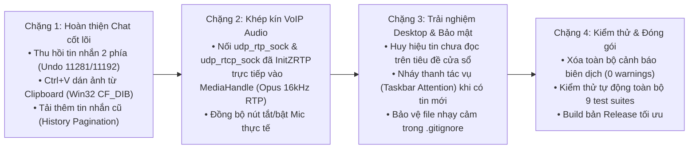

# KẾ HOẠCH HOÀN THIỆN PRODUCTION — `ctdozlite` (`zalo-rust`)

Tài liệu này tổng hợp lộ trình đưa `zalo-rust` từ bản Prototype lên bản **Production Desktop Client** ổn định để sử dụng hàng ngày thay thế Zalo PC chính thức.

---

## Kiến trúc tổng thể 4 Chặng

---

## Chi tiết kỹ thuật từng chặng

### Chặng 1: Hoàn thiện tính năng Chat văn phòng (`src/chat.rs`, `src/gui.rs`)

1. **Thu hồi tin nhắn cho cả hai phía (`recall_message`)**:
   - **Hội thoại 1-1 (`cmd 11281`)**: `POST {domains.chat}/api/message/undo?{common_params}` với payload mã hóa AES:
     `{ "msgId": msg_id, "toid": to_id, "clientId": now_ms, "cliMsgIdUndo": cli_msg_id }`.
   - **Hội thoại Nhóm (`cmd 11192`)**: `POST {domains.group}/api/group/undomsg?{common_params}` với payload mã hóa AES:
     `{ "msgId": msg_id, "grid": clean_grid, "clientId": now_ms, "visibility": 0, "cliMsgIdUndo": cli_msg_id, "imei": imei }`.
   - Bổ sung mục **"Thu hồi với mọi người"** trong menu chuột phải (`bubble_context_menu`) đối với các tin nhắn do người dùng gửi đi (`msg.is_outgoing`).

2. **Dán ảnh chụp màn hình trực tiếp từ Clipboard (`Ctrl+V`)**:
   - Đọc trực tiếp dữ liệu ảnh bitmap (`CF_DIB`) hoặc danh sách file (`CF_HDROP`) từ Clipboard của Windows bằng Win32 API gốc (không phát sinh phụ thuộc ngoài).
   - Chuyển đổi sang ảnh PNG lưu tại `stickers_cache/clip_<ts>.png` và hiển thị **Thanh xem trước ảnh đính kèm (Clipboard Image Preview)** ngay trên khung nhập tin nhắn để người dùng có thể nhập thêm chú thích rồi bấm `Enter` / `Gửi` (hoặc hủy bằng `Esc`).

3. **Tải thêm tin nhắn cũ khi cuộn lên đầu (`History Pagination`)**:
   - Hiển thị nút **"⟳ Tải thêm tin nhắn cũ"** ở đầu danh sách tin nhắn để nạp lịch sử từ máy chủ Zalo (`/api/group/history`, `get_cloud_messages`) và cơ sở dữ liệu cục bộ `zalo_history.db`.

---

### Chặng 2: Khép kín luồng âm thanh VoIP (`src/call.rs`, `src/media.rs`)

1. **Tái sử dụng đúng Socket UDP đã bắt tay `InitZRTP`**:
   - Truyền trực tiếp `udp_rtp_sock`, `udp_rtcp_sock`, `from_uid_u32` (SSRC) và `partner_uid_u32` từ `PureRustCallState` vào `MediaHandle::start_with_sockets`.
   - Đảm bảo gói tin RTP (Opus 16kHz Mono, Payload Type 112/111) đi ra từ đúng cổng UDP cục bộ đã đăng ký với máy chủ Relay của Zalo trong bước `InitZRTP` (`0x000B` / `0x000C`).
2. **Đồng bộ trạng thái tắt/bật Mic (`SetMediaState`)**:
   - Kết nối cờ `mic_muted: Arc<AtomicBool>` trong `MediaHandle` với lệnh `CallEngineCmd::SetMediaState` để khi người dùng bấm nút **Tắt tiếng** trên giao diện cuộc gọi, luồng thu âm thực tế ngừng phát gói tin RTP lên mạng.

---

### Chặng 3 & 4: Chuẩn hóa Desktop Native, Bảo mật & Chất lượng mã nguồn

1. **Thông báo & Huy hiệu tin nhắn chưa đọc (`Unread Badge & Taskbar Attention`)**:
   - Theo dõi số tin nhắn mới đến ở các hội thoại chưa mở (`unread_counts: HashMap<String, usize>`), hiển thị huy hiệu đỏ trên từng dòng hội thoại ở cột trái, cập nhật tiêu đề cửa sổ `(N) Zalo Lite` và kích hoạt `ViewportCommand::RequestUserAttention` khi có tin nhắn mới đến lúc cửa sổ không active.
2. **Bảo mật dữ liệu nhạy cảm (`.gitignore`)**:
   - Đảm bảo mọi file chứa khóa phiên hoặc nhật ký cuộc gọi giải mã (`session.json`, `call_relay.json`, `call_trace.log`, `stickers_cache/`, `*.db*`) đều được loại trừ hoàn toàn khỏi Git.
3. **Chất lượng biên dịch**:
   - Đạt **0 compiler warnings** trên toàn bộ workspace (`cargo check --all-targets` & `cargo test`).
